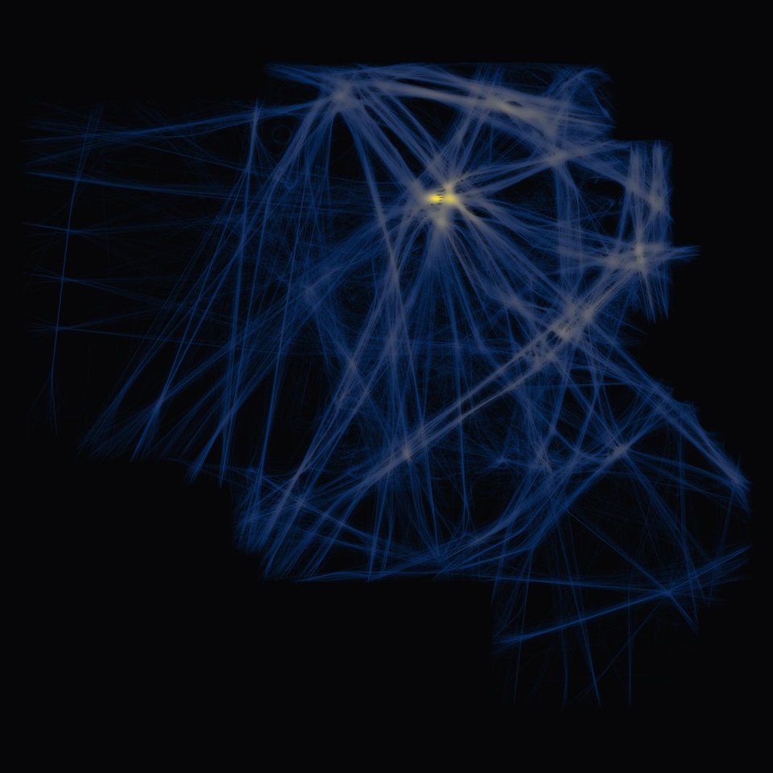
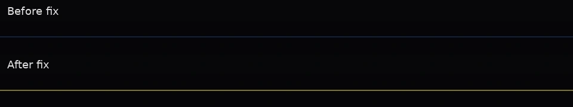

# Density view

Path colors follow the normalized density of nearby paths, using the Cividis colormap. Paths use 10% opacity so overlaps stand out against the dark background.



This image shows `data/fr-airlines.trl`, rendered at 1600 × 1600 and resized for display. Gaussian blur uses σ = 6 texels with a radius of 18 texels.

Run the windowed viewer with `cargo run`. Export the same graph with:

```sh
cargo run -- --headless --validate-gpu --input data/fr-airlines.trl --out out/fr-airlines
```

The export writes `out/fr-airlines/original.png`.

Graph construction removes repeated consecutive points and drops paths without a segment before computing normalization bounds. Resampling is mandatory for both windowed rendering and headless export. It produces a `ResampledGraph` with private fields, which is the only geometry type the GPU upload API accepts.

Resampling measures path length in the target texture's coordinates and places samples at intervals of one texel. The final interval can be shorter to preserve the endpoint. Short closed paths keep distinct points so they remain drawable. Both rendering and density counting use the same uploaded points. The vertex shader expands the graph's segments into quads, so uploads do not contain an expanded triangle mesh.

The density map matches the output dimensions. Resizing the window rebuilds both the samples and the map; uploads reject samples built for a different size. Each compute invocation rounds one existing sample to its nearest grid cell and increments one shared counter grid atomically. Two Gaussian blur passes smooth the counts, then normalization divides the field by its blurred maximum. The fragment shader samples that texture with bilinear filtering.

These crops show ten overlapping visible paths alongside 1,026 degenerate paths. Before the fix, the invisible paths raised the normalization maximum and darkened the visible paths. Excluding them restores the visible paths' peak density color. Both renders use the same blur and opacity.



Higher resolutions increase map memory, CPU resampling, and sample upload sizes. Buffer allocation uses the adapter's reported limits and rejects graphs that exceed them. Dense bundles can contend on the shared counters. Colors show density relative to each graph's own maximum, so they do not give an absolute comparison between graphs.
